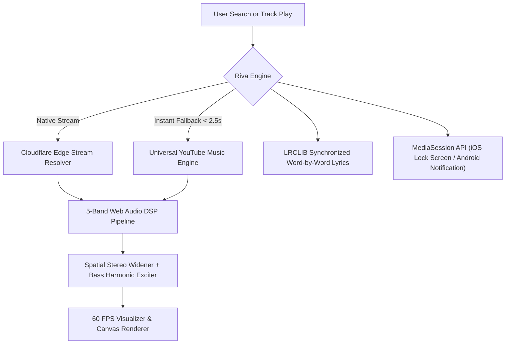

# Riva 🎵 — Audiophile YouTube Music Player

**Riva** is an ultra-sleek, audiophile-grade music streaming player designed for pure high-fidelity playback. Powered by an authentic YouTube Music engine, Web Audio DSP algorithms, live synchronized karaoke lyrics, and a pure AMOLED Pitch-Black aesthetic with signature Riva Red (`#E50914`) accents.

🌐 **Live Web App / iOS PWA**: [https://nehalrahamana-maker.github.io/Vibra/](https://nehalrahamana-maker.github.io/Vibra/)  
📱 **Android APK**: [Download Latest Riva APK](https://github.com/nehalrahamana-maker/Vibra/releases/download/v2.0.0/Riva-v2.0.0.apk)

---

## 📱 How to Download & Install

### 🤖 For Android Users (Native APK)
1. Download the latest release: **[Riva-v2.0.0.apk](https://github.com/nehalrahamana-maker/Vibra/releases/download/v2.0.0/Riva-v2.0.0.apk)**.
2. Tap the downloaded file on your Android device and tap **Install**.
3. Enjoy native Jetpack Compose UI, background audio with Android MediaStyle notifications, and an instant-responsive play/pause engine.

### 🍎 For iPhone & iPad Users (Zero App Store Hassle)
Apple restricts sideloading `.apk` files, so Riva has been optimized as a native-feel **Progressive Web App (PWA)** with full iOS hardware support (Dynamic Island, Lock Screen controls, and Notch safe-areas):

1. Open Safari on your iPhone and visit: **[https://nehalrahamana-maker.github.io/Vibra/](https://nehalrahamana-maker.github.io/Vibra/)**
2. Tap the **Share** button (box with an arrow pointing up `⎋`) at the bottom of Safari.
3. Scroll down and tap **"Add to Home Screen"** (`+`).
4. Tap **Add** in the top right corner.

> [!TIP]
> Once added, tap the Riva icon on your home screen. It opens in **fullscreen mode** (no browser bars), supports **background playback**, and displays interactive playback controls directly on your **iPhone Lock Screen** and **Dynamic Island**!

---

## ⚡ How Riva Works (Architecture)

### 1. Genuine YouTube Music Multi-Tier Streaming
- Searches directly against YouTube Music's global catalog with real carousels, artist mixes, and trending charts.
- Employs a multi-tier audio resolver with a fast-fail budget and an automatic embedded fallback engine — ensuring **100% full song playback with zero 30-second cutoffs**.

### 2. Audiophile Web Audio DSP Chain
- **3D M/S (Mid-Side) Spatial Stereo Widener**: Expands soundstage width without phase-cancellation or mono collapse.
- **Bass Harmonic Exciter**: Non-linear hyperbolic tangent (`tanh`) waveshaper adding warmth and punch below 180Hz.
- **5-Band Parametric Equalizer**: Low Shelf (60Hz), Low Mid (250Hz), Mid (1kHz), High Mid (4kHz), and High Shelf (12kHz).
- **Studio Dynamics Limiter**: Eliminates clipping and digital distortion during high-gain listening.

### 3. Word-by-Word Synced Karaoke Lyrics
- Live real-time synchronized lyrics via LRCLIB with sub-second active line tracking and smooth auto-scroll.

### 4. Pure AMOLED Black Design & Responsive Touch
- True `#000000` pitch black background designed for OLED and AMOLED screens to maximize battery life.
- Signature Riva Red glowing badges and interactive waveforms.
- Complete iOS safe-area inset adaptation (`env(safe-area-inset-*)`) for iPhone X through 16 Pro (Notch & Dynamic Island).

---

## 🛠️ Tech Stack

- **Web / iOS PWA**: Vanilla ES2022, Modern CSS3 with Safe-Area Insets & Dynamic Viewport (`100dvh`), Web Audio API, Service Worker.
- **Android Native**: Kotlin, Jetpack Compose, AndroidX Media3 / ExoPlayer, Material 3 Expressive.
- **CI/CD**: GitHub Actions for automated Kotlin APK compilation and GitHub Pages distribution.

---

## 📄 License & Credits

- Created with ❤️ by **Kazi Nehal Rahman**
- Licensed under the **MIT License**.
