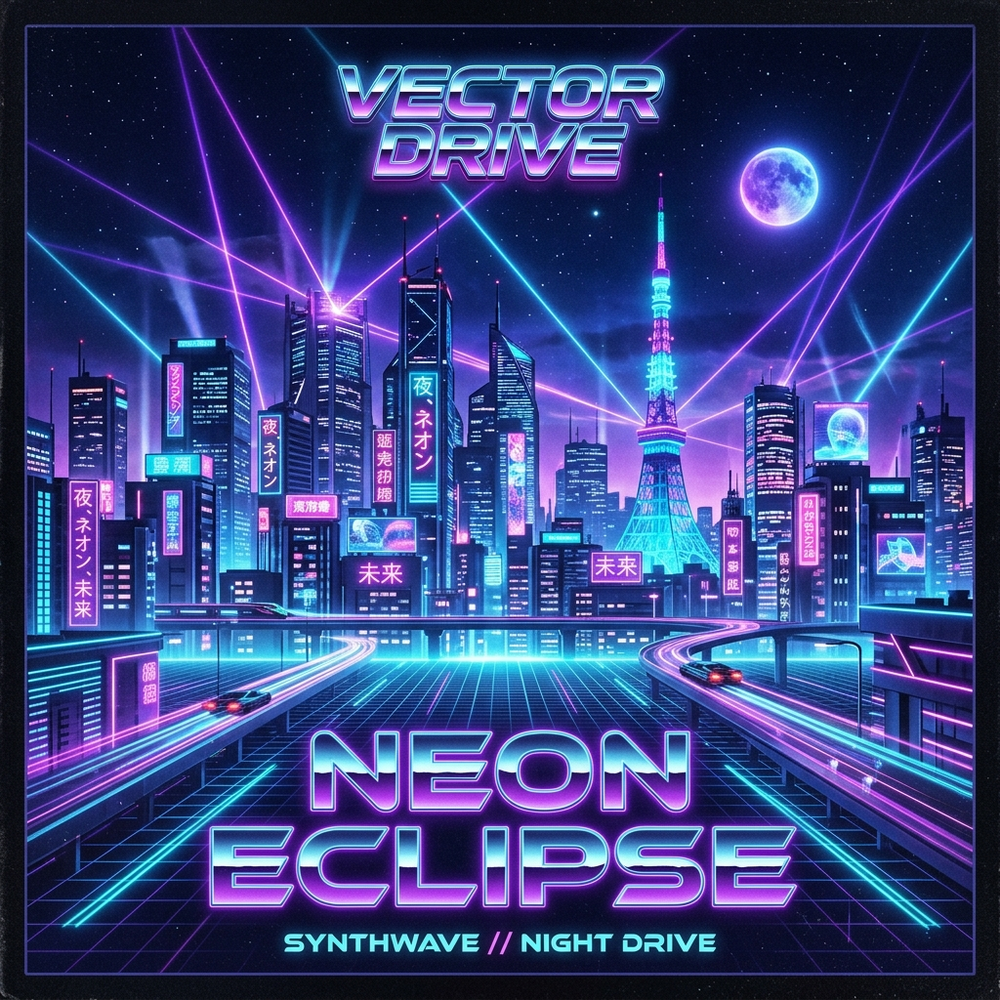

# Vibra 🎵 — Next-Gen Music Streaming & Audiophile DSP Player

[](https://github.com/nehalrahamana-maker/Vibra/actions/workflows/build-apk.yml)
[](https://github.com/nehalrahamana-maker/Vibra/actions/workflows/deploy-pages.yml)
[](https://github.com/nehalrahamana-maker/Vibra/releases)
[](LICENSE)

An ultra-sleek, audiophile-grade music streaming app & audio visualizer inspired by SimpMusic, Spotify, and Apple Music. Built with modern Web Audio DSP algorithms, live synchronized karaoke lyrics, an automated native Android APK pipeline, and an edge proxy worker.

🌐 **Live Web App / PWA**: [https://nehalrahamana-maker.github.io/Vibra/](https://nehalrahamana-maker.github.io/Vibra/)  
⚡ **Edge Proxy**: [https://vibra-api.kazimdnehal.workers.dev](https://vibra-api.kazimdnehal.workers.dev)



---

## 📱 Download Native Android App (.APK)

You can download and install the official Android APK directly on your phone:

1. Go to **[Vibra Releases](https://github.com/nehalrahamana-maker/Vibra/releases)** (or check the **Actions** tab artifacts).
2. Download **`Vibra-v2.0.0.apk`**.
3. Open the file on your Android device and tap **Install**.

---

## ✨ Features & DSP Architecture

- 🎧 **Multi-Source Streaming Engine**:
  - iTunes Search & 256kbps audio preview
  - Audius decentralized music catalog
  - Jamendo independent artist catalog
  - YouTube Music InnerTube edge streaming via Cloudflare Worker
  - Local file drag-and-drop (MP3, FLAC, WAV, AAC)
- 🎛️ **Audiophile Web Audio DSP Chain**:
  - **3D M/S (Mid-Side) Spatial Stereo Widener**: Phase-correlated spatial expansion with zero mono collapse.
  - **Bass Harmonic Exciter**: 180Hz lowpass + non-linear hyperbolic tangent (`tanh`) waveshaper for deep, punchy low-end presence.
  - **6-Band Parametric Equalizer**: 60Hz, 150Hz, 400Hz, 1kHz, 2.4kHz, 15kHz biquad filters with smooth debounced state persistence.
  - **Studio Dynamics Limiter**: Transparent compressor ceiling (-6dB threshold, 12:1 ratio) + +2.6dB makeup gain.
  - **Seamless Crossfading**: Dual-slot audio element engine with linear gain ramping and zero scrubber pops.
- 🎤 **Live Word-by-Word Synced Lyrics**:
  - LRCLIB synchronized lyrics engine with plain-text fallback
  - Spotify / custom lyrics proxy bridge with sub-second karaoke word highlighting
- 🌊 **Hardware-Accelerated Visualizer**:
  - 60 FPS HTML5 Canvas frequency spectrum, oscilloscope waves, and radial circular pulses
  - Offscreen pre-rendered glowing caps to eliminate per-frame `shadowBlur` GPU overhead
- 💾 **Offline Vault**:
  - IndexedDB binary caching with automatic LRU storage eviction when quota limits are reached
  - Full playback support in airplane mode
- 🎨 **4 Premium Themes**:
  - Apple Glass, Cyberpunk Neon, Material 3 Expressive, and Midnight AMOLED

---

## 🛠️ Tech Stack & Architecture

- **Frontend & DSP**: HTML5, Vanilla CSS3 (Custom Glassmorphism), Modern JavaScript (ES2022)
- **Audio Pipeline**: Dual-element Web Audio API (`AudioContext`, `BiquadFilterNode`, `WaveShaperNode`, `GainNode`, `DynamicsCompressorNode`, `AnalyserNode`)
- **Edge Proxy**: Cloudflare Workers (`worker.js`) running YouTube Music InnerTube, Deezer, and iTunes CORS bridges
- **Mobile Native**: Android Jetpack Compose + AndroidX Media3 / ExoPlayer (Android SDK 34, Java 17)
- **CI/CD Pipeline**: GitHub Actions for automated Kotlin APK builds and GitHub Pages PWA deployment

---

## 💻 Local Development

```bash
# Clone the repository
git clone https://github.com/nehalrahamana-maker/Vibra.git

# Open index.html in your browser
Start-Process index.html
```

---

## 📄 License

This project is licensed under the MIT License - see the [LICENSE](LICENSE) file for details.

## 👨‍💻 Author

**Kazi Nehal** — [@nehalrahamana-maker](https://github.com/nehalrahamana-maker)
